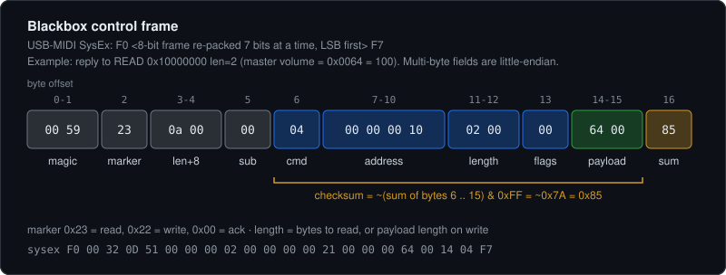

# M-Vave Blackbox — SysEx protocol

Reverse engineered from the vendor's own binaries (`M-EFCS` Windows build and
`M-UPGRADE.exe`), then verified against the physical pedal: every frame below
was either captured on the wire or synthesised from scratch and accepted by the
device.

The pedal is a standard USB-MIDI device. Linux binds it with `snd-usb-audio`
without any driver work, so parameter control needs no vendor software at all.

```
ID 4c4a:c755 Jieli Technology USB Composite Device
card N: USB Composite Device MIDI 1     <- control
card N: 44100 Hz, 24-bit, 2 in / 2 out  <- audio interface
```

## Transport

```
F0 <8-bit frame, re-packed to 7 bits> F7
```

The packer treats the 8-bit frame as one continuous **little-endian bitstream**
and emits it 7 bits at a time. This keeps every SysEx data byte below 0x80
without escaping, and it is why the raw capture looks like noise: frame
boundaries do not line up with byte boundaries.

Taken from the encoder in `M-UPGRADE.exe` at `0x140008a39` (the `0x24924925`
multiply is a divide-by-7):

```python
def pack7(data8):                    # 8-bit frame -> SysEx body
    acc = bits = 0; out = bytearray()
    for b in data8:
        acc |= b << bits; bits += 8
        while bits >= 7:
            out.append(acc & 0x7F); acc >>= 7; bits -= 7
    if bits: out.append(acc & 0x7F)
    return bytes(out)
```

`unpack7` is the same loop with 7 and 8 swapped.

## Frame



```
off  size  field
0    2     magic          0x5900 (little endian: 00 59)
2    1     marker         0x23 = read, 0x22 = write, 0x00 = ack
3    2     payload_len + 8
5    1     pad / sub-target (0x00 observed)
6    1     command        0x04            <-- checksum covers from here
7    4     address        (little endian)
11   2     length         bytes to read, or payload length on write
13   1     flags          (0x00 observed)
14   n     payload
14+n 1     checksum       ~(sum of frame[6:]) & 0xFF
```

The checksum is a one's-complement 8-bit sum, confirmed by the verifier at
`0x140016fe0` in `M-UPGRADE.exe` (`add cl,al` in a loop, then `not cl`) and by
the generator at `0x140016f73`, which starts summing at offset 6.

A read request carries no payload; `length` says how many bytes to return. The
reply reuses marker `0x23` with the data in `payload`.

## Worked example

Read the master volume (2 bytes at `0x10000000`):

```
frame  00 59 23 08 00 00 04 00 00 00 10 02 00 00 e9
sysex  F0 00 32 0D 41 00 00 00 02 00 00 00 00 21 00 00 00 69 01 F7

reply  F0 00 32 0D 51 00 00 00 02 00 00 00 00 21 00 00 00 64 00 14 04 F7
frame  00 59 23 0a 00 00 04 00 00 00 10 02 00 00 64 00 85
                                             ^^^^^ = 0x0064 = 100
```

The status read (`0x20000000`, 4 bytes) is what M-EFCS polls once a second as a
keepalive; our synthesised version reproduces the captured heartbeat byte for
byte, which is a good self-test of the codec.

## Presets

A preset is a **92-byte record**. The editor reads the working preset as a
single `READ 0x10000000 len=92`, and flash slot *N* lives at **`N * 92`** and is
directly readable — so the whole bank dumps without any vendor software.

Field offsets within the record, all confirmed against the editor's own traffic:

| Off | Size | Field |
|-----|------|-------|
| `0x00` | 2 | Master volume |
| `0x08`–`0x0D` | 1 each | Block enables: FX, AMP, CAB, MOD, REV, DLY |
| `0x0E` | 1 | FX type |
| `0x0F` | 1 | Amp selection |
| `0x14`–`0x1A` | 2 each | Effect parameters for the selected block |
| `0x20`–`0x28` | 2 each | Amp block parameters |

Writing any of these into `0x10000000 + off` takes effect **immediately and
audibly**, but only in RAM — the pedal reloads from flash on preset change, so
experiments are undone by re-selecting the preset.

### Saving

Pressing Save in the editor sends exactly three writes:

```
WRITE  N*92          len=92   <the 92-byte record>
WRITE  0xF0000000    len=0             <- commit / flush
WRITE  0xE0000000+N  len=1    01       <- mark slot N valid
```

### Switching presets

The pedal follows **ordinary MIDI Program Change** — no SysEx needed. Program *N*
selects preset *N+1*, and byte 0 of the status word reports the current index,
so a switch can be confirmed rather than assumed.

## Cabinet IRs — the `CAB` record

A cab impulse response is a **6164-byte record**: a 20-byte header followed by
2048 little-endian **24-bit PCM** samples at 44.1 kHz. Not compressed, not
frequency-domain — plain time-domain audio.

```
0..3    "CAB\0"
4..17   name, 14 bytes (the editor uses the source filename)
18      format flag = 1
19      cab level, 0..100
20..    2048 * int24 LE          (6144 bytes)
```

Uploading replicates four steps:

```
WRITE 0xA0000000 <- slot      select the target cab slot
WRITE 0x00000000 <- payload   in 1015-byte chunks
WRITE 0x00000000 <- header    20 bytes, name + level
WRITE 0xF0000113 <- 00        commit
```

Verified by capturing the editor importing a known unit-impulse WAV: the bytes
it sent were identical to the source samples, and `tools/irload.py` reproduces
its 6164-byte upload **byte for byte** from the same WAV.

### Byte 6 is a memory-space selector — this is the important one

Frame offset 6 is **not** a constant `0x04`. It selects which memory space the
address refers to:

| cmd | space |
|-----|-------|
| `0x04` | presets, working buffer, status |
| `0x05` | cab/IR storage and its name tables |

**Addresses repeat across spaces.** Address `0x00000000` with `cmd=0x04` is
preset slot 0; the same address with `cmd=0x05` is cab storage. A 6164-byte cab
record written with the wrong command lands on **preset slots 0–66**.

This cost two full preset restores before it was found, because the symptom
(cab data appearing at preset addresses) looks exactly like a "region" or
ordering problem. Two wrong theories were pursued and briefly documented here
as fact — that `0xA0000000` selected a region, and that write ordering was
load-bearing. Both were wrong; `b5` and `b13` are `0x00` in every frame either
way. Only the command byte differs.

The confirming experiment is cheap and read-only: read address 0 with each
command and compare.

```
addr 0, cmd=0x04 -> 55 00 00 01 05 02 ...   preset slot 0
addr 0, cmd=0x05 -> (cab storage)
```

Full editor upload sequence, every frame carrying `cmd=0x05`:

```
READ  0x80000000 len=280        name table (20 x 14-byte names)
READ  0x90000000 len=280        name table
WRITE 0x00000000 <- body        1015-byte chunks, name field left blank
WRITE 0xA0000000 <- slot
WRITE 0x00000000 <- header      20 bytes, real name + level
WRITE 0xF0000100 <- 00          commit  (0xF0000113 seen in another capture;
                                the low bits vary and are not yet understood)
```

`tools/irload.py` reproduces this **byte for byte** — all ten frames identical
to a captured editor upload — and an upload through it leaves all 64 preset
slots matching the backup.

Two further details recovered from the same comparison:

- the editor does **not** normalise; it preserves the source level
- samples are scaled by **2²³ (8388608)**, not 2²³−1, so a 24-bit source
  round-trips to its exact original integers

Do not sweep unknown control registers through values to see what happens. That
is a write to a state machine, not a probe.

## Amp models — the `AM4` record

Each amp is 8192 bytes beginning `AM4\0`, then a 14-byte name, a tone-stack
preamble (`12.0, 850.0, -12.0` and `12.0, 2000.0, -12.0` — ±12 dB bands at 850
and 2000 Hz, with a third at 300 Hz in the header), then roughly **2033 float32
weights** (mean 0.009, sd 0.375, range ±1.99).

`amx_parser_lib.dll` exports only `calc_bias_gru` and `calc_bias_gru_am4`, so
the model is a **GRU**, not NAM's WaveNet/LSTM.

Disassembling it settles the architecture (an earlier estimate of H≈24 from
curve-fitting the parameter count was wrong; the binary is explicit):

| Fact | Evidence |
|------|----------|
| Hidden size **16** | string `"TODO : Only support 16 hiddens now"`, and the caller passes `edx=0x10` |
| **Two** GRU units | strings `"GRU Unit init 0 ----"` / `"GRU Unit init 1 ----"` |
| **Fixed-point** runtime | weights are `mulss` by `2097151.0` (2²¹−1) then `cvttss2si` to int32 — Q11.21 |
| 16×16 weight blocks | parser strides by `0x400` = 1024 B = 256 floats = 16×16 |
| Three gates grouped | reads at `X-0x400`, `X`, `X+0x400` (r/z/n) |
| 4040-byte context | `malloc(1, 0xfc8)` |

`calc_bias_gru` itself is a **calibration pass**, not inference: it runs 44100
samples (`cmp ebx,0xac44`) of a generated signal through the model, reads 16
int32 results, scales them and stores a 16-float block tagged `"LMT"` at
model+0x1400.

Gate placement and the weight base were then settled empirically rather than
by more disassembly — see *AM4 GRU internals → Resolved by measurement* below.

The practical consequence: a NAM capture **cannot be transcoded** to this pedal,
only retrained or distilled into a 2-unit, 16-hidden GRU. That is why M-Vave
runs a training service (`/train`, `/publishtrain`, `/manage/trainmanage` on the
community site) and why the editor hashes a NAM file (`namhash`) to ask whether
a converted AMX already exists before calling `downloadAmx`.

## Amp and cab catalogue

`lib/resources/bin/blackbox/*_ampCab.bin` are **30 records of 8192 bytes**; each
record starts with a name string at offset +4 followed by its impulse response.
Records 0–19 are amps, 20–29 are cabs. Three interchangeable banks ship with the
editor: `am4` (stock), `am3` (older), and `choptones` (third-party).

## Address map

Confirmed by reading and writing against the live pedal. `0x10000000` is the
**working preset buffer** — writes take effect immediately and are *not*
committed to flash until the preset is saved, so experimenting here is
reversible by re-selecting the preset.

| Address      | Size | Meaning                                        |
|--------------|------|------------------------------------------------|
| `0x10000000` | 2    | Master volume (0–100), verified read + write   |
| `0x10000008` | 1    | CAB list selector (written on CAB tab open)    |
| `0x1000000A` | 2    | (live, `01 01`)                                |
| `0x1000000E` | 2    | (live, `01 13`)                                |
| `0x10000014`–`0x1000001A` | 2 each | Effect params, read `50` each — matches FX Gate / Gain / CAB Level in the UI |
| `0x10000020`–`0x10000028` | 2 each | Amp block params (read `82 76 43 54 55`) |
| `0x10000038`–`0x1000003E` | 2 each | (live, `43 20 23 59`)                  |
| `0x20000000` | 4    | Device status word, polled as keepalive        |

The whole `0x10000000` block responds to reads, so the map above is a starting
point rather than a limit — `blackbox.py scan` extends it safely, since scanning
only issues reads.

**The address space is not flat.** Reads past roughly `0x60` alias: `0x100000C0`,
`0x10000120` and `0x10000180` all return the same content, and a 96-byte read at
`0x10000060` does not line up with bytes at offset `0x60` of a 128-byte read from
`0x10000000`. Treat `address` as selecting a parameter group, and always read the
working preset as one `READ 0x10000000 len=92` rather than composing sub-reads.
Reads longer than the record (e.g. 128 bytes) return a mangled first four bytes;
reads of 256 bytes get no reply at all.

## Firmware / OTA

`M-UPGRADE` uses the same transport for firmware. Its shipped developer logs
(`M-UPGRADE/LOG/app_log.txt`, left in the vendor's zip by accident) document the
flow: the host sends an "upgrade mode" command, then the **device drives the
transfer**, requesting chunks by flash type, address and length, 512 bytes at a
time, until it reports completion. `.fwsc` files carry a product name and
version that the tool checks against the connected device unless `skipNameCheck`
is set.

This side is documented but deliberately untested — a failed write bricks the
pedal, and there is nothing to gain from exercising it.

## AM4 GRU internals

Read out of `amx_parser_lib.dll`, not inferred:

| Fact | Evidence |
|------|----------|
| hidden size **16** | string `"TODO : Only support 16 hiddens now"`; caller passes `edx=0x10` |
| **Q11.21** fixed point | weights `mulss` by `2097151.0` (2²¹−1) then `cvttss2si` |
| 16 units | parser loop `r9: 0 → 0x440 step 0x44` = 16 iterations, 17 int32 (68 B) per unit |
| activations are **LUTs** | 512-entry piecewise-linear tables in `.data`, domain ±16.0 in Q21 |
| sigmoid | slope `0x23000`, intercept `0x23800`, output 0…2²³ (mid 2²² = 0.5) |
| tanh | slope `0x24800`, intercept `0x24000`, output ±2²³ |

Both LUTs reproduce their float functions to **4.6e-07** — they are exactly
sigmoid and tanh, evaluated as `((slope[i]*frac)>>17 + intercept[i]) >> 2`
after `x += 2**25`, `i = x>>17`, `frac = x & 0x1ffff`. The final `>>2` converts
Q23 to Q21.

Weight block, offsets from the model base, float32 (extracted mechanically
from every load→store pair in the unrolled parser loop):

```
0x000 + 4i         gate1 input weight        16
0x040 + 4i         gate2 input weight        16
0x080 + 4i         gate3 input weight        16
0x0c0 + 64i + 4k   gate1 recurrent 16x16    256
0x4c0 + 64i + 4k   gate2 recurrent 16x16    256
0x8c0 + 64i + 4k   gate3 recurrent 16x16    256
0xcc0 .. 0xe40     six 16-float vectors (bias candidates)
                                            ---
                                            912 floats = 0xE40
```

Runtime context: gates 1 and 2 are stored interleaved as 17 int32 per unit
(16 recurrent + 1 input) at `C + 68i` and `C + 68i + 0x440`; gate 3 is kept in
separate arrays at `C + 0x880 + 64i` and `C + 0xc80 + 4i`.

### Resolved by measurement

Both open questions were settled by running candidates against a real
(dry, wet) capture from `tools/amprig.py`, scoring a linear readout
**out-of-sample** (`tools/gru_test.py`):

| base | gate order | held-out R² |
|------|-----------|-------------|
| **`0x67C`** | **g1=reset, g2=update, g3=candidate** | **+0.825** |
| `0xABC` | g1=z, g2=r | −1.212 |
| `0xABC` | g1=r, g2=z | −1.306 |
| `0x67C` | g1=z, g2=r | −1.395 |
| scrambled weights (n=5) | — | −0.412 (max +0.156) |

Only the correct combination generalises; the rest score worse than predicting
the mean. It is also **specific to the loaded model**: with the same base and
order, the amp record the pedal was actually using scores +0.825 while records
1, 2, 3, 7, 12 and 19 all score negative.

So the **weight base is `0x67C`**, and gate 1 is reset, gate 2 is update,
gate 3 is the candidate — as the storage asymmetry suggested.

The `"LMT"` anchor reasoning that gave `0xABC` was wrong: it assumed the file
record is copied verbatim into the runtime buffer at model+0x1400, and it is
not. In-sample R² would have picked the same winner but far less clearly
(0.924 vs 0.748 for the runner-up); the held-out split is what turns it into a
clean separation.

## The pedal as a USB audio interface

Configuration while capturing (`/proc/asound/cardN/pcm*c/sub0/hw_params`):

```
format S24_3LE   rate 44100   period_size 64   buffer_size 32768
PipeWire: api.alsa.period-size 64, api.alsa.headroom 64
```

Period + headroom = **128 samples ≈ 2.9 ms** of ALSA-side capture latency.
The 32768 buffer is the ring size, not latency.

**AMP block DSP latency: −21 samples (−0.48 ms) relative to bypass**, identical
across four runs. A negative delay is not physical; it is correlation bias from
the amp distorting the chirp envelope. The honest reading is that the amp block
adds **no measurable latency**, below ~0.5 ms.

Measured inside a single continuous recording with two bursts and the block
config toggled between them, because `pw-play`/`pw-record` start jitter is
±740 samples (17 ms) — far larger than the quantity being measured. Absolute
round-trip from separate processes is therefore not measurable this way; the
best-case observed arrival bounds the whole input chain (playback startup, DAC,
analog, pedal ADC, USB capture) at **≲6.4 ms**.
