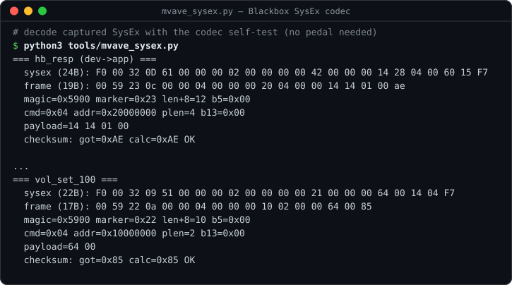

# M-Vave Blackbox on Linux

Linux tooling and protocol documentation for the **M-Vave Blackbox** guitar
multi-effects pedal / USB audio interface.

The vendor ships Windows and macOS software only. Two things work on Linux:

1. **M-EFCS, the vendor editor, runs under Wine** with a one-byte patch
   (applied by `tools/patch_mefcs.py`; the vendor binary is not in this repo).
2. **The pedal can be controlled natively** — no vendor software, no Wine —
   because its control protocol is ordinary USB-MIDI SysEx. It is documented in
   [`PROTOCOL.md`](PROTOCOL.md).

The pedal's **audio interface needs nothing at all**: `snd-usb-audio` binds it
as a class-compliant card, 44.1 kHz / 24-bit, 2 in / 2 out.



## Hardware

| | |
|---|---|
| Device | M-Vave Blackbox (firmware v20 tested) |
| USB ID | `4c4a:c755` "Jieli Technology USB Composite Device" |
| Interfaces | USB-MIDI (control) + USB audio (2 in / 2 out, 44.1 kHz, 24-bit) |
| Kernel driver | `snd-usb-audio`, no extra driver needed |

## Requirements

- Linux with ALSA; developed on Fedora with PipeWire
- `alsa-utils` (`aplaymidi`, `aseqdump`, `aconnect`) — the native CLI uses the
  ALSA sequencer, so it coexists with PipeWire holding the raw MIDI node
- Python 3.9+. `blackbox.py`, `mkmidi.py`, `mvave_sysex.py` and `patch_mefcs.py`
  need only the standard library
- `numpy` for `irload.py`, `amprig.py`, `am4.py`, `gru_test.py`
- `torch`, `scipy` and `neural-amp-modeler` for `distill.py`
- PipeWire tools (`pw-play`, `pw-record`) for `amprig.py`
- Wine (tested with Wine 11 Staging) and DXVK for the vendor editor

```
git clone https://github.com/Bulrok/mvave-blackbox-linux.git
cd mvave-blackbox-linux
python3 -m venv .venv
.venv/bin/pip install numpy scipy torch neural-amp-modeler
```

## Native control

`tools/blackbox.py` speaks the protocol directly.

```
python3 tools/blackbox.py chain               # decode the live effect chain
python3 tools/blackbox.py chain --slot 0      # ...or a stored preset
python3 tools/blackbox.py preset 21           # switch preset (Program Change)
python3 tools/blackbox.py read vol            # named fields: vol fx amp cab
python3 tools/blackbox.py write rev 0         #   mod rev dly fxtype amptype
python3 tools/blackbox.py write vol 80        # takes effect immediately
python3 tools/blackbox.py scan 0x10000000 0x10000040   # read-only discovery
python3 tools/blackbox.py monitor             # decode live traffic

python3 tools/blackbox.py backup presets.bin        # dump all 64 slots
python3 tools/blackbox.py save 61 --yes             # commit working buffer
python3 tools/blackbox.py restore presets.bin --yes # write slots back
```

`read`, `chain`, `scan` and `backup` are read-only. `write` targets the
**working preset buffer** — live and audible, but RAM only, so re-selecting the
preset undoes it.

`save` and `restore` write flash and need an explicit `--yes`; without it they
print what they would do and stop. **Take a `backup` first** — it captures all
64 slots byte-exactly, and `restore` puts them back.

The pedal is found by looking for an ALSA sequencer client whose name contains
"Composite". Other Jieli-based USB gadgets use the same generic name; if you
have one plugged in, pass the port explicitly with `-p CLIENT:PORT`
(see `aconnect -l`).

## Loading cabinet IRs

`tools/irload.py` writes a cab impulse response to the pedal without the vendor
app. It accepts any PCM or float32 WAV (mono or stereo, any rate), resamples to
44.1 kHz, fits it to the pedal's 2048-sample window and encodes the `CAB`
record.

```
python3 tools/irload.py cab.wav --slot 2              # dry run
python3 tools/irload.py cab.wav --slot 2 --yes        # upload
python3 tools/irload.py cab.wav --slot 2 --out x.cab  # just write the record
```

Validated against the vendor editor: given the same WAV, `irload.py` produces a
record **byte-identical** to the 6164 bytes M-EFCS uploads.

The pedal's IR window is only 2048 samples (~46 ms). Longer IRs are truncated
and the dropped tail is reported.

## Running the vendor editor under Wine

M-EFCS is not included here. Download the official **Windows** M-EFCS package
from M-Vave's download page (m-vave.com) yourself, then:

```
export WINEPREFIX=~/.local/share/wineprefixes/mvave
wineboot -i
winetricks dxvk                                  # optional, renders fine with it
unzip M-EFCS.zip -d "$WINEPREFIX/drive_c/"       # gives drive_c/M-EFCS/m_efcs.exe
python3 tools/patch_mefcs.py "$WINEPREFIX/drive_c/M-EFCS"

install -m755 contrib/m-efcs ~/.local/bin/m-efcs
install -m644 contrib/m-efcs.desktop ~/.local/share/applications/
```

The `.desktop` file expects `m-efcs` on your `PATH` and an icon named `m-efcs`
(e.g. the app's own icon copied to `~/.local/share/icons/hicolor/256x256/apps/m-efcs.png`).

### The one patch it needs

Stock M-EFCS aborts on startup under Wine. It is not a graphics or MIDI
problem — DXVK renders it fine and Wine's ALSA MIDI driver reaches the pedal.
The Bluetooth plugin (`universal_ble`) asks WinRT for
`Windows.Devices.Radios.Radio`, which Wine does not implement, and then calls
`combase.RoFailFastWithErrorContext`, which is also unimplemented — a
fail-fast, so the process dies.

`universal_ble_plugin.dll` exports exactly one function, the Flutter plugin
registrar. Patching its first byte to `0xC3` (`ret`) makes registration a no-op,
so the BLE plugin never initialises and never asks about radios:

```
offset 0xBB0:  40 53 48 83 ec 20 ...   ->   c3 53 48 83 ec 20 ...
               push rbx; sub rsp,0x20       ret
```

`patch_mefcs.py` checks the bytes at the patch site (and the file hash of the
known build) before writing, keeps the original as
`universal_ble_plugin.dll.orig`, is idempotent, and `--restore` undoes it.
This costs nothing: the Blackbox connects over USB, and BLE is only used for
M-Vave's wireless controllers.

Verified working: device detection, preset load, the full
FX → AMP → CAB → MOD → REV → DLY chain with live parameter values, and the
CAB import page.

`tools/watch_app.py` decodes what M-EFCS sends while you operate it, which is
how the field map was built. Note that M-EFCS **caches its own model** of the
preset: if you change things natively and then press Save in the editor, it
writes its cached copy, not your changes. Drive one or the other, not both at
once.

## Getting IRs from TONE3000

This repo does not ship a TONE3000 client, but writing your own for personal
use is straightforward. Some guidelines from building one:

- **Read and follow their API terms first.** They forbid bulk downloading,
  scraping, mirroring and caching the catalogue. Fetch one tone at a time on an
  explicit user action. Never walk the catalogue.
- **Use your own API key**, sent as a Bearer token. Keep it in an environment
  variable or a `chmod 600` file, never on the command line, and never print or
  log it.
- **Respect the rate limit** (100 requests/minute at the time of writing) and
  send an honest User-Agent.
- **Model downloads redirect to pre-signed object storage.** Drop the
  `Authorization` header when a redirect changes host. The storage URL rejects
  it, and your token shouldn't leave their domain anyway.
- **Keep attribution.** Save the creator, licence and tone metadata next to
  every file you download, and keep the credit if you ever share the IR.

Once you have a `.wav` IR, `irload.py` uploads it to the pedal.

Downloaded **NAM amp captures**, unlike IRs, **cannot** go straight to the
pedal — the pedal runs a 2-unit, 16-hidden GRU, so a NAM file
has to be retrained or distilled, not converted. See `PROTOCOL.md`.

## Amp models (AM4) — research tools

These are research tools, not a finished feature. `am4.py` and `gru_test.py`
read the amp catalogue and `amx_parser_lib.dll` from an unpacked M-EFCS; point
`$MEFCS_DIR` at the folder containing `m_efcs.exe` (default:
`extracted/M-EFCS` next to `tools/`).

### Distilling a NAM capture into the pedal's GRU

`tools/distill.py` trains the pedal's architecture to match a NAM capture.

- **Teacher**: NAM WaveNet, run with the official `neural-amp-modeler` package
  rather than a reimplementation, so a weight-ordering mistake cannot silently
  produce a wrong target. Loading is checked by asserting the parameter count
  equals the file's weight count.
- **Student**: `GRU(1, 16)` + linear readout — the architecture the pedal runs.
  PyTorch's GRU gate order is (r, z, n), which is exactly the pedal's
  gate1/gate2/gate3, so weights map across without permutation.
- **Data**: a directory of dry guitar DI WAVs (`--di`), teacher run at its
  native 48 kHz, then the pair resampled to the pedal's 44.1 kHz.

```
.venv/bin/python tools/distill.py capture.nam --di ./di --steps 3000
```

Result distilling a Marshall JCM800 2203 capture:

```
held-out ESR 1.59%   R2 0.9841
student 930 parameters vs teacher 13802   (14.8x compression)
```

The weights land in the AM4 block exactly: 3x16 input + 3x(16x16) recurrent +
6x16 biases = 912 floats. Their magnitudes (w_hh sd 0.46) also match the factory
models read at base `0x67C` (0.62-0.71), independently corroborating that base.

### Not yet loadable onto the pedal

The **output stage is not stored in the AM4 record**. Searching all 2018 aligned
offsets in the 8192-byte record for a 17-float readout that reproduces measured
hardware output gives at best R2 0.10, against 0.83 for a freely fitted one.

That fitted readout was never the pedal's readout in isolation — it was fitting
hidden state to *measured* output, which also contains the tone stack, level
stages and the analog path. The likely design is a firmware-fixed output stage
with per-amp variation carried entirely by the GRU weights and EQ preamble.

To confirm and recover it: capture several different factory amps with
`amprig.py`, fit a readout for each using its known GRU weights, and compare.
If the readout is the same across amps it is firmware-fixed and can be adopted
as a frozen output layer, and the student retrained with it held fixed — which
is what makes an exported AM4 sound right rather than merely load.

### Amp measurement rig

`tools/amprig.py` turns the pedal into a reference implementation of its own amp
model, for validating a reimplementation or a retrained one. It needs a second
audio interface whose analog output is cabled into the pedal's input (developed
with a Focusrite Scarlett 18i8):

```
                interface analog out -> pedal input -> pedal DSP
                -> pedal USB capture (44.1 kHz) -> PipeWire
```

Tell it which PipeWire nodes to use. Node names embed device serials, so they
are per-machine; find them with `pactl list short sources` / `sinks`:

```
python3 tools/amprig.py --source alsa_input.usb-Jieli_... --sink alsa_output.usb-... discover
```

or put them in `tools/amprig.local.json` (untracked) instead of passing flags
every time:

```json
{ "source": "alsa_input.usb-Jieli_Technology_...analog-stereo",
  "sink": "alsa_output.usb-...", "sink_channels": 8 }
```

`$AMPRIG_SOURCE`, `$AMPRIG_SINK` and `$AMPRIG_SINK_CHANNELS` also work.

The interface runs at 48 kHz and the pedal at 44.1 kHz, so what the pedal's ADC
actually sees is **not** bit-known from the file played. Fitting against an
assumed input would be fitting to a signal that never existed. So the pedal is
used as its own reference: capture once with **all blocks bypassed** (dry) and
once with **AMP only** (wet), same file down the same analog path. The pair is
valid regardless of what the analog path did, and alignment is recovered by
cross-correlation rather than assumed.

```
python3 tools/amprig.py discover                       # which output channel feeds the pedal
python3 tools/amprig.py verify  --channel 4            # level + noise floor check
python3 tools/amprig.py params  --channel 4            # identify the amp parameters
python3 tools/amprig.py capture --channel 4 --amp 0.55 --amp-level 22
```

Measured on the development rig:

- bypassed input noise floor rms **0.00075**
- amp parameters: `0x10000020`/`0x10000022` are level-like (5.7x output swing,
  distortion flat), `0x10000028` is drive (THD 2.4 -> 8.9, level flat),
  `0x10000024`/`0x10000026` are EQ

**Working operating point** (`--amp 0.9 --amp-level 24`):

| | rms | peak | SNR |
|---|---|---|---|
| dry | 0.178 | 0.554 | **47.5 dB** |
| wet | 0.104 | 0.677 | **42.8 dB** |

neither clipping. Both level controls matter: the input sets dry SNR, and the
amp block's output level sets wet SNR — back it off too far (14) and the wet
falls to 37.9 dB, leave it too high and the wet clips at full scale.

A captured pair shows a clean symmetric compressive transfer curve and leaves
**97% residual** after a linear fit — i.e. real nonlinearity and memory, which
is what makes it useful fitting data.

`verify` bypasses all blocks by default, so readings do not depend on the
current preset. Use `--processed` only if you deliberately want the processed
output.

`capture` writes `pair.npz` (dry, wet, rate, lag). It only ever writes the
pedal's RAM working buffer and restores from flash with a Program Change
afterwards.

## Layout

```
tools/
  blackbox.py       native CLI (read/write/scan/monitor/backup/restore)
  irload.py         cab IR uploader
  mvave_sysex.py    codec + annotated frame decoder for captured traffic
  mkmidi.py         builds a one-shot SysEx .mid for aplaymidi
  watch_app.py      live decoder for what M-EFCS sends (under Wine)
  patch_mefcs.py    the one-byte Wine patch for M-EFCS
  am4.py            AM4 amp-model record parser
  gru_test.py       weight-base / gate-order discriminator
  amprig.py         amp measurement rig
  distill.py        NAM -> pedal GRU distillation
  solve_checksum.py checksum brute-forcer (kept: it disproved the first guess)
contrib/
  m-efcs            Wine launcher for the vendor editor
  m-efcs.desktop    desktop entry for it
PROTOCOL.md         the protocol, with binary offsets for every claim
```

## Status and limitations

- Native preset read/write/save/backup/restore and cab IR upload: working and
  verified against the hardware and the vendor editor's own traffic.
- Amp model (AM4) upload: **not implemented** — the output stage is not yet
  understood (see above).
- **Firmware flashing: deliberately not implemented.** The OTA flow is
  documented in `PROTOCOL.md`, but a bad write bricks the pedal and there is no
  upside to exercising it.
- macOS: not pursued; the Windows build of M-EFCS is the one that runs under
  Wine.
- Tested with one pedal on firmware v20. Flash-writing commands (`save`,
  `restore`, `irload --yes`) are at your own risk — back up first.

## License

GPL-3.0-or-later, see `LICENSE`.

## Disclaimer

This is an independent project. It is not affiliated with, endorsed by or
supported by M-Vave. M-Vave, Blackbox, M-EFCS, TONE3000, Neural Amp
Modeler, Focusrite, Scarlett and all other trademarks belong to their
respective owners. No vendor software, firmware or data is distributed here.
